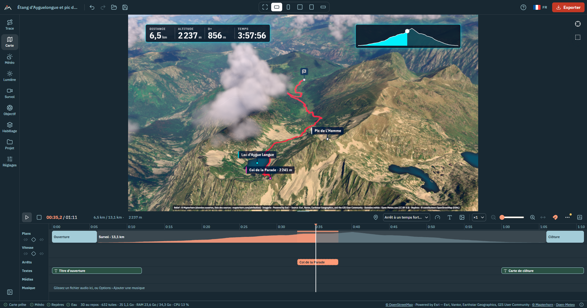

# OpenFlyover

[](https://github.com/YannickRiou/openflyover/actions/workflows/ci.yml)
[](https://github.com/YannickRiou/openflyover/actions/workflows/ci.yml)
[](https://github.com/YannickRiou/openflyover/actions/workflows/desktop.yml)
[](https://yannickriou.github.io/openflyover/)
[](LICENSE)
[](https://nodejs.org/)
[](https://www.typescriptlang.org/)
[](https://react.dev/)
[](https://threejs.org/)
[](https://vite.dev/)
[](https://v2.tauri.app/)
[](https://vitest.dev/)

OpenFlyover makes a 3D flyover movie from a GPX or FIT track, over the real terrain, with open data.

- [Overview](#overview)
- [Quick start](#quick-start)
- [Documentation](#documentation)
- [Deploying](#deploying)
- [Tests and quality](#tests-and-quality)
- [Data sources](#data-sources)
- [Licenses](#licenses)
- [Contributing](#contributing)

## Overview

**Try it in your browser: <https://yannickriou.github.io/openflyover/>** (Chrome or Edge recommended for the video export), or
download the desktop application from the [Releases](https://github.com/YannickRiou/openflyover/releases).

You import the track of an outing: hiking, trail running, cycling, ski touring… OpenFlyover lays it on 3D terrain
covered with orthophotos (orthorectified aerial photos). A camera flies over it, you edit the film on a timeline, and
you export the result as a video, a still image or a printable poster.

Everything runs locally. There is no account, no API key, no paid service and no server-side code (the optional
Strava import goes through your own Strava application). Your files stay on your machine: the app only downloads
terrain, imagery, weather and landmarks from open services. It runs as a **static website** or as a Windows, macOS or
Linux **desktop application** (Tauri), from the same code.

The interface and the texts of the films are available in **French**, **English**, **Spanish** (Español), **Italian** (Italiano) and **German** (Deutsch): pick the
language with the flag button of the top bar (next to « ? »). The first run follows the browser's language when the app offers it (else French) and the choice is
remembered on the device. The documentation is in English; the [user guide](docs/user-guide.html) quotes the interface labels in French (the reference language).



| Area | Features |
|---|---|
| Import | GPX and FIT, several tracks at once, or Strava activities; heart rate, cadence, power and temperature when present; distance, elevation gain / loss (D+ / D−), duration, elevations |
| Terrain and imagery | Mapterhorn or AWS Terrain Tiles terrain; IGN orthophotos in France and swisstopo in Switzerland, chosen automatically; Esri World Imagery elsewhere, with national aerial photos to pick by hand (Austria, Japan, United States); topographic maps; terrain exaggeration; OpenStreetMap lakes and rivers rendered as water that reflects the sky and the sun, with ripples |
| Flyover | six camera styles (chase, sway, orbit, top-down view, cinematic shot, free: keyframes only), thirteen presets, duration from 15 s to 10 min, camera smoothing, opening and closing shots (including one that dives from the highlighted region onto the track), clickable elevation profile |
| Pacing | slow-motion on the climbs and pauses at highlights (passes, nearby summits), speed sections you set on the timeline |
| Light | physically based sky and haze, sun at the actual time of the outing, terrain shadows, starry night, automatic exposure |
| Weather | historical weather for the day of the outing (Open-Meteo), or the forecast for an upcoming outing (up to 16 days), shown in a panel and in the scene; volumetric clouds derived from low, mid and high cloud cover (a station about every 10 km, so the sky changes along the track; or set by hand), pushed by the wind, with their shadows on the terrain; a sea of clouds filling the valleys, as volumetric clouds or as a lit surface |
| Look | color grading presets; lens effects, all off by default: speed blur, bloom, lens flare, depth of field |
| Landmarks | summits, passes, huts, lakes… from OpenStreetMap; climbs detected and categorized (cat. 4 to HC); 3D labels; automatic stops in the movie at the passes crossed and the summits near the track; one list along the track where each landmark is Auto, Always or Never shown (a density, few / normal / many, decides the Auto ones), a window with the map and the elevation profile to browse them, and a stop in the film at any of them with its duration |
| Planned outing | for a route without times (Komoot, Visorando, IGNrando…): date, start time, activity and pace give the estimated passing time at each point, the sun and the weather forecast of the day |
| Points of interest | your own places ("Picnic", "Paul's chalet"), placed with a right-click on the terrain or at the marker, with an icon (hut, bivouac, summit…), shown like landmarks in the view and in the movie |
| Track | colored by speed, slope, elevation, heart rate, cadence, power or temperature; width, dashes or dots, glow, track that draws itself as the marker passes; smoothing of GPS jitter |
| Marker | ball, figurine (hiker, mountaineer, runner, trail runner, cyclist, e-bike, bikepacking, mountain bike, skier, ski touring, swimmer, kayak, rider, paraglider, motorbike, car, light aircraft) facing the direction of travel, or your photo in a circle; adjustable size |
| Ghost race | several tracks replayed together, with a live leaderboard |
| Stages | several tracks flown one after the other, each stage with its own color, name, figures, sun and weather |
| Chaining | several tracks (one per day, or one outing recorded in two files) merged into a single route, flown over in one go |
| Overlay | titles, counters, profile, mini-map, weather, logo, text, ghost race leaderboard, texts, photos and videos from the timeline burned into the movie, source credits; seven styles whose colors and fonts can be changed, for the whole overlay or element by element |
| Music | one or more music tracks on the timeline (MP3, M4A, OGG, WAV, FLAC), with volume and fades; played during playback and mixed into the exported video, with the sound of the videos; music optionally lowered under the videos |
| Export | MP4 or WebM video in 16:9, 9:16, 1:1, 4:5 or 21:9, from 720p to 4K, at 24, 30 or 60 frames per second, with the music and the sound of the videos; PNG or JPEG still image; the overlay alone on a transparent background (WebM); several formats in one go; on the desktop, one film per track of a folder, also from the command line |
| Offline | tiles of the track downloaded once, along a corridor of 2, 5 or 10 km: the view and the export then work without a connection |
| Poster | printable poster of the outing in A4 or A3 (300 dpi, portrait or landscape) or square: 3D view of the whole track, title, date, key figures, profile, weather of the day, credits; the same seven styles; several tracks on the same poster, each in its color, with their list or their total; "Carte à plat" (flat map) for a map seen from above |
| Timeline editing | keyframes on the camera, on every setting with a slider (sun hour, exposure, grading, speed…) and on the 3D labels, written by the sliders or by moving the view with the mouse; rectangle selection (Ctrl + drag) to move or delete several keys; right-click menu to add or delete a key or an item; texts, photos and videos follow the route when a section is slowed down or sped up |
| Project | project file to save and reopen, undo / redo, presets; « Nouveautés » window (what each version brings, by feature); on the desktop, a button to check for updates |

How to use each of these: the [user guide](docs/user-guide.html).

## Quick start

You need:

- **Node.js 24**;
- a recent **Chrome or Edge**. The 3D view uses WebGL 2 and video export uses WebCodecs, the browser's video encoding
  API. Export has not been tested in Firefox or Safari;
- a decent graphics card: it sets the export speed;
- an Internet connection, for the tiles (the small square images of terrain and map).

```bash
git clone https://github.com/YannickRiou/openflyover.git
cd openflyover
npm ci
npm run dev
```

Open <http://127.0.0.1:5173> and click "Try the sample" ("Essayer avec l'exemple" in French).

To test the production build: `npm run build`, then `npm run preview` (<http://localhost:4173>).

### Notes for the development machine

- **WSL**: run `source ~/.nvm/nvm.sh && nvm use 24` before `npm`.
- **Windows**: Node 24 installed with fnm may not be in the PATH. Run `fnm use 24` before `npm`, or prepend the fnm
  installation folder of Node 24 to PATH.

## Documentation

| Document | For |
|---|---|
| [User guide](docs/user-guide.html) | using the app: import, planning, editing, export, offline, shortcuts |
| [Knowledge base](docs/how-it-works.html) | how the app is built, explained for newcomers to web development |
| [Developer handbook](docs/handbook/index.html) | how the project was built and how to change it (history, web and Rust notions explained, repository tour, recipes, release), to maintain it without help |
| [`ARCHITECTURE.md`](ARCHITECTURE.md) | coordinates, shared contracts, modules: read it before coding |
| [Self-hosting](docs/self-hosting.md) | run your own copy of the website: Caddy, Docker or nginx, HTTPS, updates, what leaves the browser, your own map servers |
| [Deploying and building](docs/deploying.md) | web server setup (HTTPS, nginx, Apache), desktop application build |
| [Desktop installers](docs/installers.md) | installers built on GitHub, signing, automatic updates (maintainer setup) |
| [Data sources](docs/sources.md) | attributions, licenses, offline rules and how each source was checked |
| [Changelog](CHANGELOG.md) | what each version brings |

The HTML pages are standalone: open them in a browser from a clone, or through any static host.

## Self-hosting

You can run your own copy of the website on your own server and domain: it is a folder of static files (no server
program, no database, nothing stored on the server; the tracks of your visitors never leave their computers). In short:

```bash
git clone https://github.com/YannickRiou/openflyover.git && cd openflyover
npm ci && npm run build     # the site is in dist/
```

then serve `dist/` over **HTTPS** with Caddy (automatic certificate), Docker + nginx, an existing nginx / Apache or any
static host. The full path (the three ways, updating, a subfolder or your own domain, what the visitors' browsers
contact, using your own tile / landmark / weather servers, a checklist and fixes) is in
[`docs/self-hosting.md`](docs/self-hosting.md).

## Deploying

OpenFlyover is a static site: build it with `npm ci && npm run build`, copy `dist/` to the root of a domain and serve
it over **HTTPS** (the video encoder and track import need a secure context outside `localhost`). The desktop
application is built with `npm run tauri:build`; installers for the three systems (on Windows the installer asks whether to install for the current user or for all users) are also built on GitHub
(*Actions* › "Desktop installers"), and published as a release when a `v*` tag is pushed. Details, server configuration and limitations: [`docs/deploying.md`](docs/deploying.md).

### Automatic updates: maintainer setup

The desktop application has a « Rechercher une mise à jour » button (« Réglages » tab) that reads the latest GitHub release
**only when pressed** (nothing at start-up, nothing in the background; `github.com` is contacted only then). It needs an
update signing key, created once (full guide, tests and common errors: [`docs/installers.md`](docs/installers.md#automatic-updates-maintainer-setup)).
**This is already done for this repository**: the public key is committed in `plugins.updater.pubkey` of `src-tauri/updater.conf.json`, and
the secret `TAURI_SIGNING_PRIVATE_KEY` is set (no `TAURI_SIGNING_PRIVATE_KEY_PASSWORD` secret exists, which works only because the key has no password).
What you must keep: **the private key file** (outside the repository, in a password manager: without it no installed
copy can be updated, and a new key means a new release that users install by hand). Each `v*` tag then publishes the signed
update packages and `latest.json` with the release; the release must be published, not a draft, for the button to find it.

Without the secret the installers are built as before and the button says that updates are not available in that build.

## Tests and quality

| Command | Purpose |
|---|---|
| `npm run dev` | development server on <http://127.0.0.1:5173> |
| `npm run build` | type check, then production build in `dist/` |
| `npm run preview` | serves `dist/` on <http://localhost:4173> |
| `npm test` | runs all tests (vitest) |
| `npx vitest run --maxWorkers=1` | the same tests on a single core, more stable on a busy machine |
| `npm run coverage` | the tests with code coverage (summary in the terminal, `coverage/coverage-summary.json`); CI publishes the line coverage as the README badge |
| `npm run typecheck` | TypeScript type check |
| `npm run lint` | code analysis (oxlint) |
| `npm run e2e` | end-to-end tests in a real browser (see below) |
| `npm run tauri:dev` / `npm run tauri:build` | desktop application in development / installers of your own system (Rust and the Tauri prerequisites needed, see [`docs/deploying.md`](docs/deploying.md)) |
| `npm run notices` | regenerates `THIRD_PARTY_NOTICES.md` and the installer licence pages; run it when a dependency changes |
| `npm run installer-assets` | regenerates the installer images (needs Chrome, see `OPENFLYOVER_CHROME` below) |

The suite has **about 2,700 tests** in 164 files (15 October 2026), each file next to its module (`src/**/*.test.ts`,
`*.test.tsx` for the components); network calls and the video encoder are mocked. `npm run e2e` drives the app in a headless Chromium
through 21 scenarios (home, tabs, language, timeline, project, export, phone…); its options (`OPENFLYOVER_CHROME`,
`OPENFLYOVER_E2E_SKIP_EXPORT`, `OPENFLYOVER_E2E_ONLY`) are documented at the top of `e2e/run.mjs`. On Windows or macOS
the default Chromium path (a Linux one) does not exist: point `OPENFLYOVER_CHROME` at your Chrome, for example
`C:\Program Files\Google\Chrome\Application\chrome.exe` (PowerShell: `$env:OPENFLYOVER_CHROME = '…'`), and use a UTF-8 locale
(the project scenario checks the name of a downloaded file with accents). The rendering
quality is checked by eye (the manual checks of the [developer handbook](docs/handbook/index.html#manual-checks)).

## Data sources

All sources are open and keyless; the code declares them in `src/terrain/sources.ts`.

| Source | Used for | License |
|---|---|---|
| Mapterhorn, AWS Terrain Tiles | terrain | open data (CC BY 4.0, OGL, public domain…) |
| IGN Géoplateforme | orthophotos and Plan IGN in France | Licence Ouverte Etalab 2.0 |
| swisstopo | orthophotos and national map in Switzerland | open data (OGD) |
| Esri World Imagery | world orthophotos (default outside France and Switzerland) | Esri terms: credited "Powered by Esri", never in offline packs; keyless use is not covered by Esri's terms, a choice made knowingly ([details](docs/sources.md)) |
| basemap.at | aerial photos of Austria | CC BY 4.0, credit "Datenquelle: basemap.at" |
| GSI Japan | aerial photos of Japan | Public Data License 1.0, credit GSI |
| USGS The National Map | aerial photos of the United States | public domain, credit USGS |
| OpenTopoMap | world topographic map | CC BY-SA |
| Open-Meteo | historical weather and forecast | CC BY 4.0, **non-commercial** API |
| OpenStreetMap (Overpass) | landmarks, water bodies | ODbL |

The track itself is never sent: services only receive the tile area, a few points rounded to 1 km for the weather and
the rectangle around the track for landmarks. Displayed attributions, offline-pack rules, request limits and the
verification log: [`docs/sources.md`](docs/sources.md).

## Licenses

The OpenFlyover code is under the **MIT license** ([`LICENSE`](LICENSE), © 2026 Yannick Riou). The licenses of everything it
redistributes (npm packages, Rust crates, fonts, icons, data) are in [`THIRD_PARTY_NOTICES.md`](THIRD_PARTY_NOTICES.md),
generated by `npm run notices`.

| Dependency | Version | License |
|---|---|---|
| three | 0.186.1 | MIT |
| @react-three/fiber, drei, postprocessing | 9.8.1, 10.7.9, 3.1.3 | MIT |
| postprocessing | 6.39.5 | Zlib |
| @takram/three-atmosphere, three-clouds, three-geospatial | 0.19.1, 0.7.6, 0.9.1 | MIT |
| mediabunny | 1.61.3 | MPL-2.0: usable as is; a modification of its files must be published |
| zustand | 5.0.15 | MIT |
| @heroui/react, @heroui/styles | 3.2.6 | MIT |
| react-aria, react-aria-components | 3.53.1, 1.22.1 | Apache-2.0 |
| react, react-dom | 19.3.0 | MIT |

**FIT files.** They are read by a small decoder of the project (`src/import/fit.ts`, MIT), written from the public
description of the FIT protocol. The Garmin FIT SDK is not used: its license forbids redistributing it, and the published
site would have contained it.

The development tools are not shipped with the site: Vite, vitest, oxlint, jsdom and Tailwind CSS (build time only) are under
MIT, TypeScript and puppeteer-core (end-to-end tests) under Apache-2.0.

Embedded files:

- **Fonts** Fraunces and IBM Plex, under SIL Open Font License 1.1 ([`public/fonts/README.md`](public/fonts/README.md)).
- Interface **icons**: paths from [Lucide](https://lucide.dev) (ISC license, notice in `src/ui/icons.tsx`),
  built into the code.
- **Sky textures** and star catalog, from the `@takram/three-atmosphere` package (MIT), and **cloud
  textures** (local weather, shapes, turbulence) from the `@takram/three-clouds` package (MIT). The site serves them itself. The stars come from the Yale Bright Star Catalog, whose license is not stated.
- **EGM96 geoid** (1° grid, `src/geo/egm96Grid.ts`), derived by `scripts/gen-geoid.mjs` from the NGA 15' grid
  redistributed by PROJ-data (`us_nga_egm96_15.tif`), public domain.
- **Sample track**: a real hike (Étang d'Ayguelongue and Pic de l'Homme, Ariège), a lighter copy of the author's recording; the synthetic Tour du Mont-Blanc stage of `scripts/gen-sample-gpx.mjs` is the fixture of the tests.

**Exported videos.** They contain map data under its own license
([see the sources](#data-sources)). You must therefore credit these sources when you distribute a
video. The application burns them into each exported video and still image, and at the bottom of each poster (terrain, imagery,
and Open-Meteo / OpenStreetMap when the weather or the landmarks are loaded). During the film they are discreet by default (the
names of the holders in small capitals in a corner); "Habillage" › "Crédits des sources" can show the whole sentence instead, or
nothing but the end of the film, which always closes with the full credits. "Copier les crédits" in the export drawer gives the
text with its links for the description of the video. What each source requires is in [`docs/sources.md`](docs/sources.md#attribution-in-the-film-short-form--full-form--where).

## Contributing

How to set up, test and open a pull request: [`CONTRIBUTING.md`](CONTRIBUTING.md). Security problems: [`SECURITY.md`](SECURITY.md).

Conventions:

- Two targets, both always working: the hosted static website (no application server, no Node at run time) and the desktop application (Tauri); disk access and storage go through the common interface of `src/platform` (browser / Tauri).
- No API key and no paid service: open sources only, cached, with their terms of use respected.
- Strict TypeScript, with `import type` and no `enum`.
- Interface in French, English, Spanish, Italian and German (`src/i18n`, see "Internationalisation" in [`ARCHITECTURE.md`](ARCHITECTURE.md)): no text in the code, every string goes through `t('domain.key')` and has a message in each language.
- Visual identity in [`src/ui/theme.css`](src/ui/theme.css). Styling in Tailwind utilities (shared `@utility` classes in `src/ui/utilities.css`), interactive components on HeroUI behind the wrappers of `src/ui/primitives/` (screens never import `@heroui/react`): see "Primitives" and "Styling" in [`ARCHITECTURE.md`](ARCHITECTURE.md).
- Open, keyless sources only; any new source goes into `src/terrain/sources.ts` and `docs/sources.md`.
- The documentation (README, `ARCHITECTURE.md`, `docs/`) is written in English; interface labels quoted from the app stay in French.
- Types, lint and tests green before each commit, one commit per feature (`npm run typecheck`, `npm run lint`, `npx vitest run --maxWorkers=1`).

Read [`ARCHITECTURE.md`](ARCHITECTURE.md) (coordinate conventions, contracts in `src/core/types.ts`, modules) and the
[developer handbook](docs/handbook/index.html) (recipes, release procedure) before changing the code.
